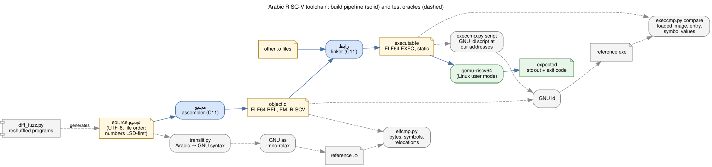
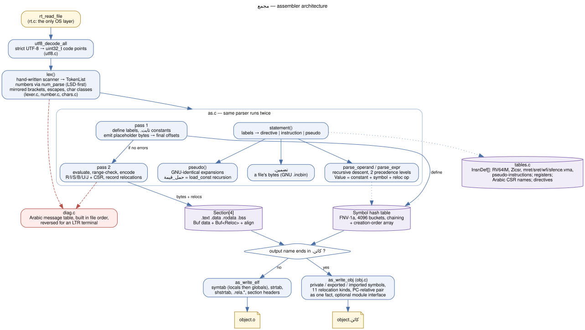
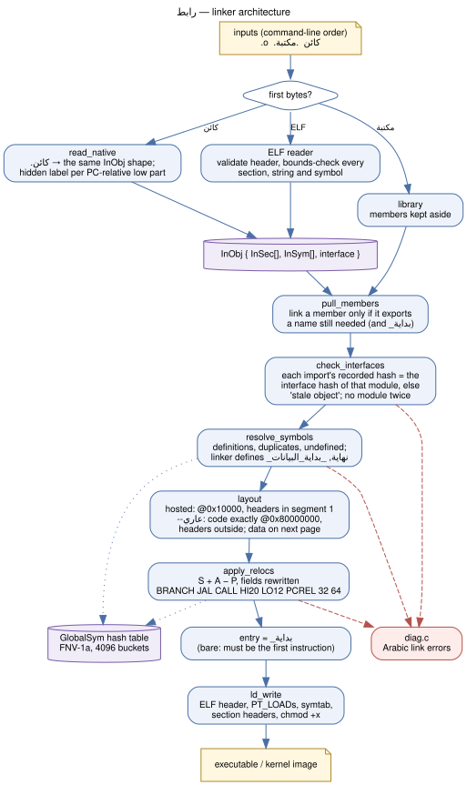

# Architecture: assembler (مجمع) and linker (رابط)

This document describes how the two finished tools are built: the pipeline, the modules, the data structures and the algorithms. The diagrams are Graphviz sources in [diagrams/](diagrams/) (`.dot`), rendered to SVG next to them. To regenerate: `dot -Tsvg diagrams/X.dot -o diagrams/X.svg`.

## 1. Pipeline

- Source files (`.تجميع`) are UTF-8 in **file order**, the order the programmer types in Vim Arabic mode. Number runs are stored least significant digit first.
- `مجمع` turns one source file into an ELF64 relocatable object (`ET_REL`, `EM_RISCV`), byte-identical to GNU `as -mno-relax` on the transliterated source.
- `رابط` links objects into a static ELF64 executable. Its loaded image is identical to GNU ld placing the same objects at the same addresses.
- Dashed path: the test oracles. `translit.py` converts Arabic assembly to GNU syntax. `elfcmp.py` compares objects, `execcmp.py` compares executables, and `diff_fuzz.py` generates random variants of the test programs and checks both tools against GNU.

Source layout:

| Directory | Contents | Lines (approx.) |
|---|---|---|
| `src/common/` | rt (OS layer), utf8, chars, number, buf, elf.h, diag | 1,100 |
| `src/as/` | lexer, tables, as.c (two passes + ELF writer), main | 2,500 |
| `src/ld/` | ld.c (reader, resolver, layout, relocations, writer), main | 900 |
| `tools/`, `tests/gen/` | Python oracles, runners, fuzzers, test generators | 1,100 |

## 2. Assembler (مجمع)

1. **Read and decode.** `rt_read_file` (the only place that touches the OS) reads the file. `utf8_decode_all` turns it into an array of `uint32_t` code points and rejects invalid UTF-8.
2. **Lex.** `lex()` scans the code points once and produces a `TokenList`:
   - number runs go through `num_parse`, least significant digit first, with the `٠س` / `٠ث` base markers;
   - `)` / `]` become OPEN tokens and `(` / `[` become CLOSE tokens (mirrored brackets);
   - string escapes are decoded into UTF-8 bytes;
   - Latin digits and letters, Persian digits, tatweel, tashkeel and presentation forms are rejected.

   If the lexer reports any error, the assembler stops.
3. **Pass 1.** `statement()` parses every line: labels, then a directive, an instruction or a pseudo-instruction.
   - Labels and `.ثابت` constants are defined.
   - Every instruction and directive emits placeholder bytes, so all offsets are final after this pass. Nothing is relaxed, and `حمل_قيمة` needs its value known at that point, so sizes never change.
4. **Pass 2.** The same parser runs again over the same tokens.
   - Operands are evaluated and range-checked, and instructions are encoded.
   - Relocations are recorded, with the field contents GNU writes.
5. **Write the object.** `as_write_elf` builds the symbol table (null, section symbols, locals, then globals, with `sh_info` = first global). It also builds the string tables, one `.rela.*` per section with relocations, and the section headers.
6. **Diagnostics.** `diag.c` builds every message in file order: path, line and column (in Arabic digits, least significant first), then the Arabic text. On output it reverses the whole line, then reverses Latin runs back. A plain left-to-right terminal then shows what Vim rightleft would show.

## 3. Linker (رابط)

1. **Read objects.** `ld_read_object` validates the ELF header (64-bit, little-endian, `ET_REL`, `EM_RISCV`). It bounds-checks every section, string and symbol against the file size, so corrupted objects are rejected instead of crashing the linker.
2. **Classify sections.** Input sections go to one of four outputs by name prefix (`.text*`, `.rodata*` / `.srodata*`, `.data*` / `.sdata*`, `.bss*` / `.sbss*`). Non-ALLOC sections are dropped, and any other ALLOC section is an error.
3. **Resolve symbols.**
   - First the definitions: a duplicate strong definition is an error, and a strong definition beats a weak one.
   - Then every strong undefined reference must be defined somewhere. An undefined weak symbol resolves to 0.
4. **Layout.**
   - Input sections are concatenated in command-line order, each at its own alignment.
   - Segment 1 (R+X) is at 0x10000: ELF header, program headers, `.text`, `.rodata`.
   - Segment 2 (R+W) starts on the next page, with its address congruent to its file offset modulo 4 KiB: `.data`, then `.bss`.
5. **Apply relocations.**
   - For each RELA entry: value = S + A (− P for pc-relative types). The value is range-checked, the instruction field is cleared and the new value written in.
   - `PCREL_LO12` relocations point at a label. The linker finds the `PCREL_HI20` relocation at that label's address and uses its value.
6. **Write the executable.** ELF header with entry `_بداية`, one or two `PT_LOAD` program headers, the contents, a symbol table for debugging, section headers. The file is then marked executable.

## 4. Data structures

### Shared (`src/common`)

| Structure | File | What it is | Why |
|---|---|---|---|
| `RtBuf` | rt.h | file contents + length | the OS layer's only data type |
| `Arena` / `ArenaBlock` | rt.c | bump allocator over a linked list of 1 MiB blocks, freed all at once | no per-object frees; trivial to port to the new language |
| `Buf` | buf.c | growable byte array (doubling) with little-endian writers | section contents, relocation arrays, token arrays, ELF output |
| code point array | utf8.c | `uint32_t[]` of the whole file | the lexer indexes characters, not bytes |
| `NumResult` | number.h | value, base, end index, error kind + position | one shared number reader for every tool |
| `Line` | diag.c | fixed `uint32_t[1024]` message buffer | built in file order, reversed in place for display |
| message table | diag.c | `const char *[D_COUNT]` indexed by `DiagId` | all Arabic wording in one place |

### Assembler (`src/as`)

| Structure | File | What it is |
|---|---|---|
| `Token` / `TokenList` | lexer.h | tagged struct (kind, line, column, name bytes, value, base, local-label direction, bracket kind, string bytes) in one contiguous array |
| `InsnDef[]` | tables.c | static table: Arabic mnemonic, format, opcode, funct3, funct7 or shift bits, shift limit, pseudo kind; matched by exact name (linear search, about 80 entries) |
| `FixedReg[]`, `RegFamily[]` | tables.c | ABI register names, and prefix families (`سجل` `مؤقت` `محفوظ` `وسيط`) with a mapping array; the numeric suffix is read least significant digit first |
| `DirDef[]` | tables.c | directive name to `DirKind` |
| `Symbol` + hash table | as.h | name, defined, section, value, global, constant, referenced, ELF index; 4096 buckets with chaining (FNV-1a), plus an array in creation order for deterministic output |
| `LocalCount[]` | as.h | per local label number, how many definitions so far; gives the GNU-style names `.L<n>^B<k>` |
| `Section[4]` | as.h | `Buf` contents, `.bss` size, `Buf` of `Reloc`, alignment |
| `Reloc` | as.h | offset, type, symbol, addend |
| `Value` | as.c | expression result: 64-bit constant, optional symbol, relocation operator, provisional flag (pass-1 guess), from-character flag |
| `Words` | as.c | fixed array of up to 16 instruction words for one pseudo-instruction expansion |
| `Assembler` | as.h | the whole state: tokens, position, pass, current section, sections, symbols, local counters |

### Linker (`src/ld`)

| Structure | File | What it is |
|---|---|---|
| `InObj` | ld.h | one input object: path, file bytes, section and symbol arrays |
| `InSec` | ld.h | input section header + chosen output section + offset inside it |
| `InSym` | ld.h | input symbol + pointer to its `GlobalSym` when global or weak |
| `GlobalSym` + hash table | ld.h | defined, weak, defining object and symbol index; 4096 buckets with chaining (FNV-1a) |
| `Rela` | ld.c | decoded relocation entry |
| `Linker` | ld.h | objects, global table, per output section: size, alignment, address, file offset, contents `Buf`; entry; program header count |

## 5. Algorithms

### Text and numbers

- **Strict UTF-8 decoding.** Length from the lead byte, continuation-byte check, and rejection of overlong forms, surrogates and values above U+10FFFF.
- **Number parsing, least significant digit first.**
  - value += digit × multiplier, then multiplier ×= base.
  - Overflow is caught by checking before each multiply and add, and by remembering when the multiplier itself has overflowed. Leading zeros (which come last in the file) are then still accepted.
  - Base markers, digit-group separators and the per-base digit limit are validated in the same loop.
- **Number formatting.** Emits digits in the same file order, so diagnostics and any future generated source always follow the convention. Unit tests check that parsing and formatting round-trip.
- **Display transform for diagnostics.** Reverse the line, then reverse each Latin run back. It's a minimal BiDi for a terminal that has none.

### Assembler

- **Scanner.** Single pass, one code point of look-ahead. After an error it skips to the end of the line, so several errors can be reported in one run.
- **Expressions.** Recursive descent with two precedence levels (`* /` above `+ -`), left-associative in file order, plus unary minus and bracket groups. Values combine as follows:
  - constant ± constant, symbol ± constant and constant + symbol are allowed;
  - symbol − symbol is a constant when both labels are in the same section;
  - anything else with two symbols is an error.
- **Two-pass assembly with fixed sizes.** Pass 1 defines labels and emits placeholders. Pass 2 encodes. Because nothing changes size, two passes are always enough.
- **Numeric local labels.** Each definition of N increments a counter. A backward reference uses the current count and a forward reference uses count + 1. This reproduces GNU's `.L<n>^B<k>` names exactly.
- **Encoding.** Bit-field packing for the R, I, S, B, U and J formats.
  - `%hi` / `%lo` split: hi = (x + 0x800) >> 12, lo = the low 12 bits sign-extended, so that hi × 4096 + lo = x.
- **`حمل_قيمة` (li) expansion.** GNU's `load_const`:
  - a single `جمع_فوري` if the value fits in 12 bits;
  - otherwise `حمل_علوي_فوري` + `جمع_فوري_كلمة` for 32-bit values;
  - otherwise build the upper part recursively, shift it into place with `رفع_فوري` (counting trailing zeros), then add the low 12 bits.

  Checked against GNU on 222 values.
- **GNU-compatible relocation fields.** Branches and jumps get S + A − P (with S = 0 when undefined), `%hi` / `%lo` get only the addend, data and pc-relative fields get 0.
- **Code padding.** A zero byte to an even offset, a 2-byte `0x0001`, then 4-byte nops. `.text` is padded at its end to its alignment, as GNU does.
- **ELF symbol ordering.** Locals before globals (required by ELF); undefined referenced symbols become global; numeric labels are emitted only when referenced.

### Linker

- **Two-step symbol resolution.** Collect definitions with the strong/weak rules, then verify the undefined references, reporting each missing name once.
- **Section layout.** Concatenate in input order, rounding each offset up to the section's alignment. The output alignment is the largest input alignment.
- **Segment layout.** Put the data segment on the next page with its address congruent to its file offset (mod page size), so the file needs no padding.
- **Relocation application.**
  - Compute the value, check the range (branch ±4 KiB, jump ±1 MiB, hi20 within signed 32 bits, 32-bit data), mask out the old field and insert the new one.
  - `CALL_PLT` writes both the auipc and the jalr.
  - `PCREL_LO12` finds its `PCREL_HI20` partner by scanning the relocations for one at the label's address (linear scan, fine at this size).

### Testing

- **Differential testing against GNU.** Every test is assembled by `مجمع` and by GNU as (through the transliterator) and the objects are compared semantically. Every program is linked by `رابط` and by GNU ld (through a generated linker script with our addresses) and the loaded images are compared.
- **Generated tests.** Python generators write the large tests with numbers converted to file order automatically, so no literal is hand-reversed by mistake.
- **Fuzzing.**
  - Line-level mutation (delete / duplicate / swap) of valid programs, for the differential checks.
  - Character-level mutation of sources and byte-level corruption of objects, run under AddressSanitizer and UndefinedBehaviorSanitizer to look for crashes.

## 6. Compiler (مترجم), first version

| Stage | File | What it does |
|---|---|---|
| Loading | `src/cc/main.c` | Reads the root module, follows `استورد` through the search path (root directory, then the given paths such as `lib/`), detects import cycles, orders modules dependencies first. |
| Lexing | `src/cc/lex.c` | Same character classes, number rules and escapes as the assembler (shared `chars.c` / `number.c`); keywords; glyph-meaning brackets and comparisons. |
| Parsing | `src/cc/parse.c` | Hand-written recursive descent, one function per rule. Strict precedence: brackets are required when mixing `و`/`أو`, bitwise with arithmetic or comparison, and comparison chains are rejected. Struct literals are disabled in conditions so `إذا أ == ب }` opens the block. |
| Checking | `src/cc/check.c` | Name resolution (modules, `عام`, no shadowing), lazy resolution of types/enumerations/constants with cycle detection, struct layout with the no-hidden-padding rule, exact constant arithmetic for literals (sign + 64-bit magnitude), typed constant folding with run-time semantics, safe implicit conversions only, definite assignment for `غير_مهيأ` (bitsets merged at branches), all-paths-return, exhaustive `حسب`. |
| Code generation | `src/cc/gen.c` | Stack machine over the RISC-V LP64 ABI: values in `وسيط٠` (`وسيط١` for slices), aggregates by address, 16-byte pushes, frame pointer `محفوظ٠`; canonical sign/zero extension after every operation; structures ≤ 16 bytes in registers, larger by reference; far-safe branches. Emits Arabic assembly in file order through `number.c`. |
| Runtime | `lib/runtime/تشغيل.تجميع` (generated by `tools/gen_runtime.py`) | `_بداية` builds the argument slices and calls `رئيسية`; memory copy; write/exit; run-time stops. |
| Standard library | `lib/غرة/نصوص.غرة` | Printing text and numbers, written in غرة. |
