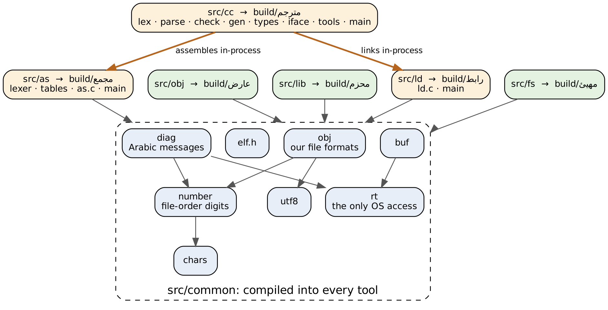
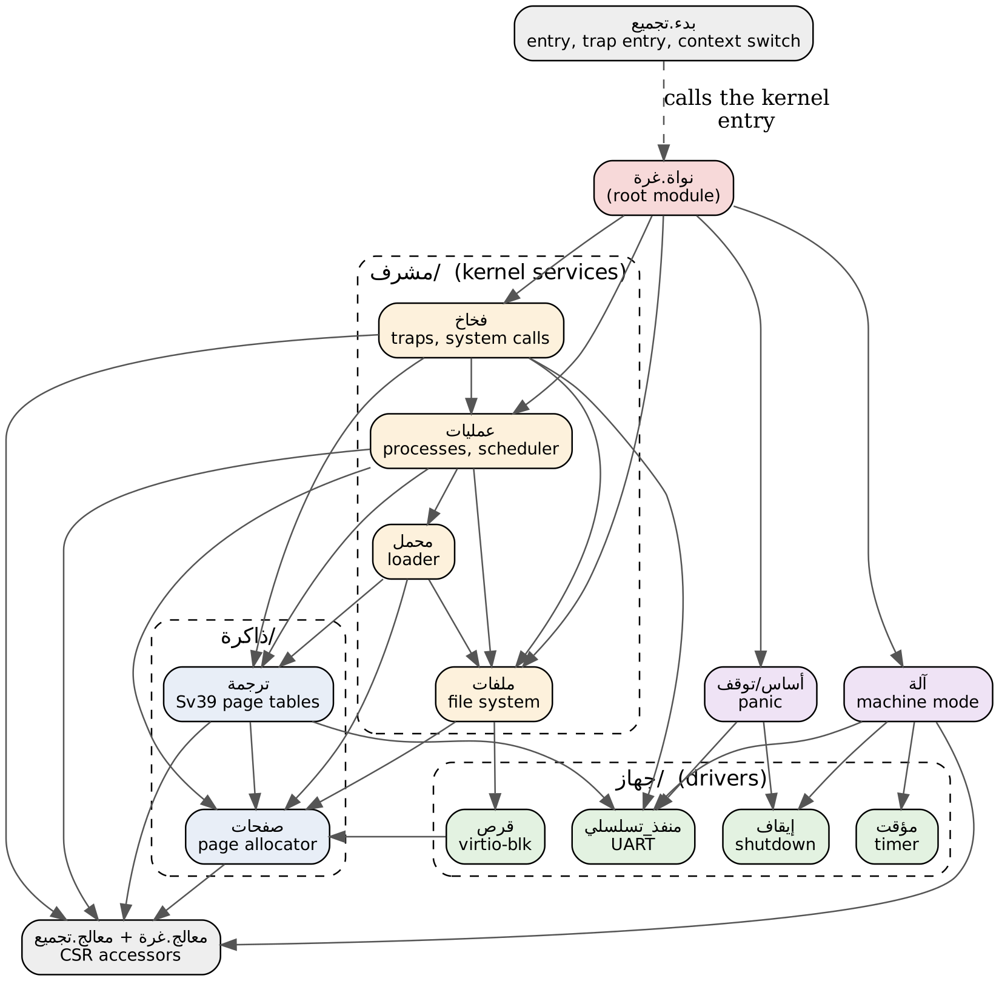
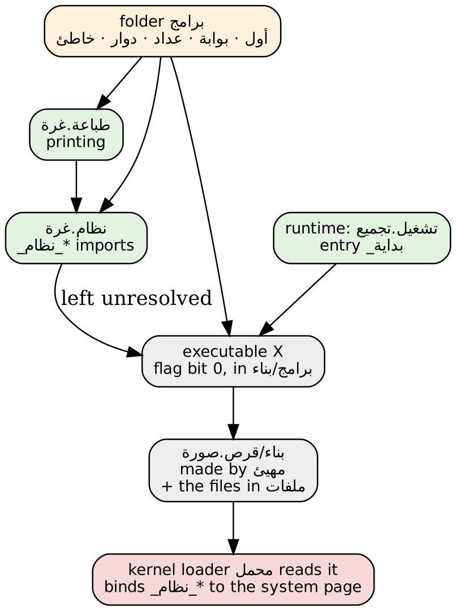

# Repository map: arabic-riscv-toolchain

What each folder and file is for, and how the pieces depend on each other. This is a snapshot of the repository at commit 5700ea0, "OS stage 6".

## 1. The big picture

The repository has six top-level parts. Data flows through them in one direction:

| Part | Language | Role |
|---|---|---|
| `src/` | C11 | The toolchain: assembler, linker, compiler and three small tools |
| `lib/` | Assembly + غرة | Runtime and standard library for programs that run on Linux |
| `os/` | Assembly + غرة | The operating system, which runs bare-metal on QEMU |
| `tests/` | test inputs | One folder per tool, each input stored with its expected result |
| `tools/` | Python, shell | Test runners, GNU oracles, the OS build, the docs PDF and the diagrams |
| `docs/` | Markdown, Graphviz | Specs, decisions, assumptions, roadmap, architecture |
| `مصدر/` | غرة | Phase 6: the toolchain rewritten in غرة, module for module (`مشترك/` = `src/common`; `عارض.غرة`, `محزم.غرة` so far) |

At the top level:

- **`Makefile`** builds the six programs into `build/` and runs every test suite.
- **`README.md`** is the front page.
- **`CLAUDE.md`** holds the working rules.
- **`.gitignore`** keeps `build/` and every `بناء/` folder out of git.

The path from source to a running system:

1. The compiler مترجم turns `.غرة` source into `.تجميع` assembly.
2. The assembler مجمع turns assembly into `.كائن` objects. The packer محزم can bundle objects into a `.مكتبة` library.
3. The linker رابط turns objects into a Linux program, a bare kernel image, or one of our executables.
4. The disk maker مهيئ puts the executables and files on a disk image.
5. QEMU boots the kernel. The machine layer آلة starts the kernel نواة, its loader محمل loads programs from the disk, and the shell بوابة takes commands.

The Makefile builds six programs, all into `build/`:

| Program | Built from | What it does |
|---|---|---|
| `build/مجمع` | `src/as` + `src/common` | Assembler: `.تجميع` → ELF object or `.كائن` |
| `build/رابط` | `src/ld` + `src/common` | Linker: objects and libraries → Linux executable, bare kernel image, or our executable |
| `build/مترجم` | `src/cc` + `src/as` + `src/ld` + `src/common` | Compiler: `.غرة` → assembly → object → executable, all in one process |
| `build/عارض` | `src/obj` + `src/common` | Viewer: prints what is inside a `.كائن`, `.مكتبة` or executable |
| `build/محزم` | `src/lib` + `src/common` | Packer: packs objects into a `.مكتبة` library |
| `build/مهيئ` | `src/fs` + `src/common` | Disk maker: builds the disk image with its file system |

Note that the compiler does not run the assembler and linker as separate programs. Their C files are compiled into `مترجم` itself.

## 2. src/: the toolchain in C

There are two rules:

- Every tool sits on top of `src/common`.
- A tool never includes another tool's headers. The one exception is the compiler, which calls the assembler and linker through `src/cc/tools.c`.

### 2.1 src/common: the shared foundation

This is the layer to port first when bootstrapping.

| File | Role | Used by |
|---|---|---|
| `rt.c/h` | **The only door to the operating system**: open, read and write files, make directories, run processes, exit. No other C file calls libc I/O. | every tool's `main.c`, `diag`, `buf` |
| `number.c/h` | **The only place numbers are read and printed.** Arabic digits in file order (least significant first). | lexers, `diag`, `obj`, compiler |
| `utf8.c/h` | UTF-8 decoding and encoding | lexers, `obj`, compiler |
| `chars.c/h` | Character classes: Arabic letters, digits, punctuation | lexers, `number` |
| `buf.c/h` | Growable byte buffer | everything that builds output |
| `diag.c/h` | Every error message, in Arabic, with file and line | every tool |
| `elf.h` | ELF64 and RISC-V relocation constants | assembler, linker |
| `obj.c/h` | Our file formats: the `.كائن` object (header, symbols, relocations, the interface region, the FNV-1a hash), the `.مكتبة` library, and executables (flag bit 0, fixed layout at 0x10000). Also the dump code that عارض prints. | assembler, linker, compiler, عارض, محزم |

### 2.2 src/as: the assembler (مجمع)

| File | Role |
|---|---|
| `lexer.c/h` | Turns Arabic assembly text into tokens: names, file-order numbers, registers, directives |
| `tables.c/h` | Lookup tables: every instruction and how it is encoded, register names, CSR names, directives (including `.تضمين`) |
| `as.c/h` | The assembler itself, about 1,800 lines. Two passes (labels, then encoding), expressions, relocations, and output either as ELF or as `.كائن` with an optional interface region |
| `main.c` | Command line |

### 2.3 src/ld: the linker (رابط)

| File | Role |
|---|---|
| `ld.c/h` | Reads ELF objects and `.كائن` objects into one in-memory shape. Pulls members out of `.مكتبة` libraries, checks that interface hashes match, lays out sections, defines `_نهاية` and `_بداية_البيانات`, applies the relocations, and writes the output. |
| `main.c` | Command line. It picks one of three output modes. |

The three output modes:

- **Hosted** (the default): a Linux ELF executable.
- **`--عاري`** (bare): a kernel image at 0x80000000.
- **`--برنامج`** (program): our executable at 0x10000, with the `_نظام_` imports left open for the OS loader.

### 2.4 src/cc: the غرة compiler (مترجم)

It's a classic pipeline. Each stage's output is the next stage's input:

| File | Stage | Role |
|---|---|---|
| `lex.c` | 1 | Source text → tokens |
| `parse.c` + `ast.h` | 2 | Tokens → syntax tree. `ast.h` defines the tree nodes |
| `types.c` | (helper) | Type sizes, alignment, packed structs |
| `check.c` | 3 | Scopes, name resolution, type checking, imports, the `متطاير` rules |
| `gen.c` | 4 | Tree → RISC-V assembly text in our Arabic syntax |
| `iface.c` | 5 | Writes the module's public interface as غرة text into the object, and reads it back for the modules that import it |
| `tools.c/h` | 6 | Calls the assembler and linker in-process (`tool_assemble`, `tool_link` in hosted, bare or program mode) |
| `main.c` | driver | Build mode: follows imports, keeps objects in `بناء/`, skips a module that is already up to date (by comparing interface regions), and accepts extra inputs (`.تجميع`, `.كائن`, `.مكتبة`) |
| `cc.h` | | Shared declarations for all the stages |

### 2.5 The three small tools

| Folder | Program | Role |
|---|---|---|
| `src/obj/main.c` | عارض | Prints the contents of an object, library or executable. Useful for debugging and teaching |
| `src/lib/main.c` | محزم | Packs several `.كائن` files into one `.مكتبة` |
| `src/fs/main.c` | مهيئ | Creates the 32 MiB disk image (512-byte blocks, magic `دليل`), with directories, and copies files onto it |

## 3. lib/: for programs that run on Linux

| File | Role |
|---|---|
| `lib/runtime/تشغيل.تجميع` | Entry point `_بداية` and Linux system calls for hosted programs, including the Linux primitives of `غرة.منصة` (generated by `tools/gen_runtime.py`) |
| `lib/غرة/نصوص.غرة` | The start of the standard library: text functions |
| `lib/غرة/منصة.غرة` | The platform library (docs/spec-platform.md): files, directories, the environment, memory and arenas. The Phase 6 tools reach the system only through it, on Linux and on our OS |

## 4. os/: the operating system, in غرة

The OS is built with the same tools as everything else, with no firmware underneath. The kernel modules import each other the way the compiler's build mode follows imports. Each arrow below means "imports":

### 4.1 Kernel files, from the bottom up

| File | Layer | Role |
|---|---|---|
| `بدء.تجميع` | entry | First instruction at 0x80000000: stacks, trap entry and exit (the 272-byte frame, sscratch), the context switch `_بدل_السياق`, the system page, the load buffer |
| `معالج.تجميع` + `معالج.غرة` | CPU | Small assembly functions that read and write CSRs. The `.غرة` file is their interface, so the غرة modules can import them |
| `آلة.غرة` | machine mode | PMP, trap delegation, forwarding the timer to supervisor mode, then the drop into supervisor mode |
| `جهاز/منفذ_تسلسلي.غرة` | driver | Serial port (UART): the console |
| `جهاز/مؤقت.غرة` | driver | Machine timer |
| `جهاز/إيقاف.غرة` | driver | QEMU test device: power off with an exit code |
| `جهاز/قرص.غرة` | driver | virtio-blk disk (modern MMIO, polling) |
| `ذاكرة/صفحات.غرة` | memory | Free list of 4 KiB physical pages |
| `ذاكرة/ترجمة.غرة` | memory | Sv39 page tables: map, unmap, free. The RSW bit marks shared pages |
| `مشرف/ملفات.غرة` | kernel | The flat file system on the disk: open, read, write, close |
| `مشرف/محمل.غرة` | kernel | The loader: reads an executable, maps it, and binds its `_نظام_` imports to the system page |
| `مشرف/عمليات.غرة` | kernel | Up to 8 processes, `شغل` (spawn), wait and exit, round-robin scheduling on each tick |
| `مشرف/فخاخ.غرة` | kernel | Trap handler: decodes the cause, handles system calls and the timer, kills a faulting process |
| `أساس/توقف.غرة` | base | Panic: print a message and stop |
| `نواة.غرة` | root | The main kernel module: starts every part in order, then runs the first process |

### 4.2 User side: programs on the disk

| File | Role |
|---|---|
| `مستخدم/runtime/تشغيل.تجميع` | Program entry `_بداية` (the same code as on Linux: the kernel builds a Linux-style stack with the arguments), the OS primitives of `غرة.منصة`, and the language stops (generated by `tools/gen_runtime.py`) |
| `مستخدم/نظام.غرة` | Declares the system services as `_نظام_` imports: write, exit, wait, yield, the process number, spawn. The linker leaves them unresolved and the kernel loader binds them |
| `مستخدم/طباعة.غرة` | Printing text and numbers, built on نظام |
| `برامج/أول.غرة` | The first process. It runs the demo programs and waits for them, reads and writes a disk file, then starts the shell |
| `برامج/بوابة.غرة` | The shell: reads a command from the keyboard and runs the program with that name |
| `برامج/عداد.غرة`, `دوار.غرة`, `خاطئ.غرة` | Small programs that exercise the scheduler and fault handling: a counter, a busy spinner, a program that faults |
| `برامج/صدى.غرة` | Prints its arguments |
| `برامج/تجربة_المنصة.غرة` | Runs the `غرة.منصة` checks on our OS: arguments, arenas on the heap, nested directories, files |
| `ملفات/رسالة` | An ordinary text file that مهيئ puts on the disk |

### 4.3 How the OS is built (`tools/build_os.sh`)

1. Each program in `برامج/` is compiled with the `مستخدم` library in `--برنامج` mode. The result is an executable in `برامج/بناء/`.
2. The kernel `نواة.غرة` is compiled in `--عاري` mode together with `بدء.تجميع` and `معالج.تجميع`.
3. مهيئ creates `بناء/قرص.صورة` with all the programs and the files from `ملفات/`.
4. QEMU runs it with `-machine virt -bios none`: the kernel image is the first thing that runs.

All the output goes to `بناء/` folders, which git ignores.

## 5. tests/: one folder per tool

Each test is an input file next to its expected result:

- `.out`: expected output.
- `.code`: expected exit code.
- `.err`: expected error message.
- `.norun`: build only, don't run.
- `.in`: keyboard input.
- `.out2`: output of a second boot on the same disk.

| Folder | Tests | Run by |
|---|---|---|
| `asm/` | Assembler programs, compared with GNU as | `tools/run_asm_tests.sh` + oracle |
| `errors/` | Assembler error messages (56 cases) | `run_asm_tests.sh` |
| `link/` | Multi-file link tests (each test is a folder) | `run_link_tests.sh` |
| `link-errors/` | Linker errors: undefined, duplicate, jump too far, missing entry… | `run_link_tests.sh` |
| `cc/` | Programs in غرة with expected output, plus C files compiled by GCC and linked in to test the ABI | `run_cc_tests.sh` |
| `cc-errors/` | Compiler error messages (46 cases) | `run_cc_tests.sh` |
| `os/` | Whole-system boots on QEMU: the real kernel and small test kernels | `run_os_tests.sh` |
| `unit/` | `test_common.c`: unit tests for `src/common` | `make unit` |
| `gen/` | Python generators that produced the large test sets | run by hand |
| `port/` | Phase 6: the غرة code in `مصدر/` against the C code (unit checks, diagnostics, the ported tools) | `run_port_tests.sh` |

`make test` runs every suite: unit, oracle, asm, link, cc, objfmt, build-mode, os and spec-check.

## 6. tools/: helpers in Python and shell

| File | Role |
|---|---|
| `run_asm_tests.sh`, `run_link_tests.sh`, `run_cc_tests.sh`, `run_obj_tests.sh`, `run_build_tests.sh`, `run_os_tests.sh` | The test runners behind the `make` targets |
| `translit.py` | Translates our Arabic assembly into GNU syntax, so the real GNU assembler can be the oracle |
| `elfcmp.py`, `execcmp.py`, `run_oracle.sh` | Compare our output with GNU binutils: object contents, and what an executable loads |
| `diff_fuzz.py` | Random differential fuzzing against GNU binutils (`make fuzz`) |
| `gen_runtime.py` | Generates both start files (`lib/runtime` for Linux, `os/مستخدم/runtime` for our OS), converting their numbers to file order |
| `run_port_tests.sh` | Phase 6: compares each ported piece with its C original (`make port`) |
| `gen_spec.py` | Builds `docs/spec-language.md` from the `.src.md` source, turning number placeholders into file order (`make spec`) |
| `build_os.sh` | Builds the programs, the kernel and the disk (section 4.3) |
| `docs_pdf.py` | Markdown → PDF, with Arabic shown exactly as in the editor (`make docs`). This document was made with it |
| `render_diagrams.py` | Graphviz `.dot` → SVG and PNG, fixing the direction of mixed Arabic and English labels (`make diagrams`) |

## 7. docs/: the specification

The specs are the source of truth. The code follows them.

| File | Role |
|---|---|
| `spec-assembler.md` | Assembly syntax, directives, instructions |
| `spec-linker.md` | Linker behaviour and output modes |
| `spec-language.src.md` → `spec-language.md` | The غرة language. Edit the `.src.md`, then generate |
| `spec-object.md` | The `.كائن`, `.مكتبة` and executable formats |
| `spec-os.md` | OS design: memory map, traps, processes, system calls, running it |
| `spec-fs.md` | The disk layout and file system (version 2: subdirectories) |
| `spec-platform.md` | The platform library `غرة.منصة` and its two back ends |
| `decisions.md` | Every decision the owner has made (63 so far) |
| `assumptions.md` | Things assumed until they are decided (A1–A82) |
| `roadmap.md` | Phases. Phase 5 (the OS) is complete; phase 6, bootstrapping in غرة, has started |
| `repo-map.md` | This document: every folder and file and how they relate |
| `port-names.md` | Phase 6 glossary: every C name and its غرة name, and the translation conventions |
| `architecture.md` + `diagrams/` | Overview, with twelve Graphviz diagrams rendered to SVG and PNG |

## 8. How everything relates, in one paragraph

`src/common` is the foundation every C tool is built on. The assembler and linker are separate programs, and the compiler also contains them so it can build in one process. Those tools turn `lib/` into Linux programs and `os/` into a kernel image, executables and a disk image. `tests/` holds the expected results for each tool. `tools/` runs the tests, checks our output against GNU binutils, and builds the OS, the PDFs and the diagrams. `docs/` says what all of it must do, and every change to a rule goes through `decisions.md`.
